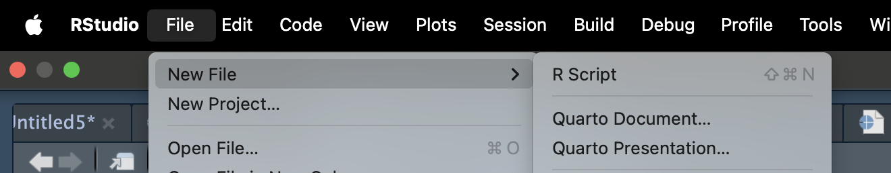

Download the link to the quarto template here

```{r, echo=FALSE}
xfun::embed_file("lab09.qmd")
```

## Introduction

The goal of today's workshop is to generate a simple quarto presentation and explore how to create some presentation aspects. You will be creating a presentation for your final assessment so this is a great time to explore some different slide types.

Specifically we will explore:
- simple slides
- slide and section titles
- lists
- figures and figure formatting
- slide formatting options
- columns
- code and output formatting
- tables
- equations


## Quarto presentations overview

Quarto supports a variety of formats for creating presentations, including:

revealjs — reveal.js (HTML)

pptx — PowerPoint (MS Office)

beamer — Beamer (LaTeX/PDF)

There are pros and cons to each of these formats. The most capable format by far is revealjs, so it is highly recommended unless you have specific Office or LaTeX output requirements. Note that revealjs presentations can be presented as HTML slides or can be printed to PDF for easier distribution.


### Try yourself

Start by opening a new quarto presentation and set the format to revealjs



## Simple slides

We are going to start with making basic slides. 

In a quarto presentation two number (pound/hash) keys start a new slide. 

Then you can place text below to make the body of the slide.


## Titles and heading

Level 1 headings (#) identify sections and Level 2 headings identify slides (##). These headings also create breaks between slides. For breaks between slides without titles, use dashes ---.

### Try yourself

Make a simple slide show with two slides (each defined with a level 2 heading (##)):

- one slide for what you ate for lunch one day this week
- one slide for your favorite hobby

On each slide include a title and the ingredients in your lunch or points about your favorite hobby

- Add a third slide to your presentation without a title
- Render the document and observe your slides

## Lists

Lists can be a useful way to present series of information.

You can create an unordered list by starting each line with - (or * or +) followed by a space, ensuring there is a blank line before the first element:

My list:

- First item
- Second item
- Third item

Leaving no blank lines between the items will result in a compact list, while leaving a blank line between items will create a loose list with more vertical spacing.

You can create numbered lists simply by using a number followed by a full stop at the start of each line for example `1.`. The actual numbers you use doesn’t matter—Quarto will renumber the list automatically, i.e. you could use 1. for every item.

## Incremental Lists

By default number and bullet lists within slides are displayed all at once. 

You can override this globally using the incremental option in the format part of the yaml or top section of your quarto document. For example:

title: "My Presentation"
format:
  revealjs:
    incremental: true   

You can also explicitly make any list incremental or non-incremental by surrounding it in a div with an explicit class that determines the mode. To make a list incremental do this:

::: {.incremental}

- Eat spaghetti
- Drink wine

:::

To make a list non-incremental do this:

::: {.nonincremental}

- Eat spaghetti
- Drink wine

:::

### Try yourself

- On the slide about your lunch, create a list of the ingredients in your lunch (have at least 3 ingredients)
- Render the document and observe the list
- Change the global option to be incremental 
- Render the document and explore how the list advances

## Figure Basics

Here I use 'figure' to mean any image/vector object inserted into a presentation from a saved file. It can have the file extension .jpeg, .jpg, .png, .pdf

A figure is created whenever a captioned image appears by-itself in a paragraph. Using ``, the exclamation point tells quarto to put the figure 'here', any text inside the square brackets acts as a caption for the image, and inside the parentheses place the file path with figure name and appropriate file type.

For example:


## Figure Sizing

By default figures are displayed using their actual size (subject to the width constraints imposed by the page they are rendered within). You can change the display size by adding the width and height attributes to the figure. For example:

{width=300}

Note that if only width is specified then height is calculated automatically to keep the same proportions as the original file. If you want to modify this default behaviour just add an explicit height attribute.

The default units for width and height are pixels. You can also specify sizes using a percentage or a conventional measurement like inches or millimetres. For example:

{width=80%}

{width=4in}

### Try yourself

1. Look up pixbay.com for royalty-free images. Find any image you like and download a copy. (I suggest shortening the file name) Make sure the you place the image in the same folder as your quarto document (or you know the path to this image). 
2. Add this image to one of your slides. Render the document.
3. Adjust the size. Render the document.


## Multiple Columns

To put material in side by side columns, you can use a native div container with class .columns, containing two or more div containers with class .column and a width attribute:

:::: {.columns}

::: {.column width="40%"}
contents...
:::

::: {.column width="60%"}
contents...
:::

::::

Add columns to one of your slides. Render the document.

### Try yourself

1. Make a new slide with two columns. 
2. In one column put your image and in the other write a short description of the image.
3. Render your document. Adjust the widths of the columns as necessary.

## Adding code

In quarto presentations we can add code and/or the output of code.

To add code insert a chunk and your code or write inline code.

Inline code you use a single tick (`) to start the code and then the abbreviation for the language. For example:
`r `

## Chunk options

Insert code chunks using the 'plus' button or the syntax (```)

Code block options are included in a special comment at the top of the block (lines at the top prefaced with `#|` are considered options).

| Option | Description| 
|---------|----------------------|
| eval     | Evaluate the code chunk (if false, just echos the code into the output).   |   
| echo     | Include the source code in output  |   
| output       | Include the results of executing the code in the output (true, false, or asis to indicate that the output is raw markdown and should not have any of Quarto’s standard enclosing markdown).    |    
| warning       | Include warnings in the output.    |    
| error       | Include errors in the output (note that this implies that errors executing code will not halt processing of the document).    |    
| include       | Catch all for preventing any output (code or results) from being included (e.g. include: false suppresses all output from the code block).    |    
| renderings | Specify rendering names for the plot or table outputs of the cell, e.g. [light, dark]   |  

## Code output Options

There are a number of ways to control the width and height of outputs generated from code. 

Quarto sets a default width and height for outputs appropriate to the target output format:

| Format |Default size (in)| 
|---------|--------|
| Default     | 7 x 5   |   
| HTML Slides     | 9.5 x 6.5  |   
| HTML Slides (reveal.js) | 	9 x 5  |    
| PDF       | 5.5 x 3.5 |    
| PDF Slides (Beamer)	  | 10 x 7  |    
| PowerPoint | 7.5 x 5.5 |    
| MS Word, ODT, RTF | 	5 x 4  |  
| EPUB | 	5 x 4  |  
| Hugo | 	8 x 5  |  

You can change the default sizes using the fig-width and fig-height options. These can be inserted using `#|` at the top of the chunk.


```{r, echo = FALSE, eval=TRUE}
#| message: FALSE

library(tidyverse)

lego_sets <- read_csv("https://www.massey.ac.nz/~jcmarsha/data/lego/lego_sets.csv")
lego_parts <- read_csv("https://www.massey.ac.nz/~jcmarsha/data/lego/lego_parts.csv.gz")
```

Here I use the default sizing:
```{r, eval=TRUE, warning=FALSE}
ggplot(data=lego_sets) +
  aes(x=year, y=price) +
  geom_point()
```


While here I adjust the sizing:
```{r, eval=TRUE, warning=FALSE}
#| fig-width: 5
#| fig-height: 3

ggplot(data=lego_sets) +
  aes(x=year, y=price) +
  geom_point()
```

## Caption and Alt Text

You can specify the caption and alt text for figures generated from code using the fig-cap and fig-alt options.

For example, here we add these options to a code chunk that creates a plot:

```{r, eval=TRUE, warning=FALSE}
#| fig-cap: "Lego sets price over time"
#| fig-alt: "A point plot about lego sets price"

ggplot(data=lego_sets) +
  aes(x=year, y=price) +
  geom_point()
```

### Try yourself

1. Add a new slide, insert a new code chunk from lab one like below. Set eval to TRUE for your chunk.


2. Make another code chunk to produce a chart that looks at the relationship between price and year of lego sets.

3. Adjust the code chunk so your code is not displayed but the chart is. 

4. Add a caption and alt text to your figure output.

5. Render the document and examine the size of the figure output. How does it appear on the slide? Do you want to make any adjustments to the size?


## Tables

The most commonly used markdown table is known as a pipe table. Pipe tables support specifying per column alignment as well as captions. For example:

| Default | Left | Right | Center |
|---------|:-----|------:|:------:|
| 12      | 12   |    12 |   12   |
| 123     | 123  |   123 |  123   |
| 1       | 1    |     1 |   1    |


Since the pipes indicate column boundaries, columns need not be vertically aligned, as they are in the above example. So, this is a perfectly legal (though ugly) pipe table

fruit| price
-----|-----:
apple|2.05
pear|1.37
orange|3.09

### Try yourself

- Generate a table of fruit prices like the one above 
- Right align the text in the fruit column and left align the numbers in the price column

## Mathematical equations

You can include formulas and equations in your document using TeX math syntax. TeX math is the notation originally developed for the TeX typesetting system. It’s now the de facto standard across technical writing tools — Wikipedia, scientific journals, Jupyter notebooks, and nearly every markdown processor understand it. If you’re new to TeX math, the LaTeX Wikibook’s Mathematics chapter is a gentle tutorial. Not all TeX math constructs are supported, but most of the common ones are. The best way to know whether a particular construct is supported is to render and see.

There are two ways to include math: inline math, using single `$`, appears within a line of text; while display math, using `$$` appears centered on its own line.


## Additional information

https://quarto.org/docs/presentations/revealjs/

## Finishing up

As this is a Quarto document, we can **Render** it to a nice, self-contained .HTML report.

**Make sure you can Render your full document successfully.**