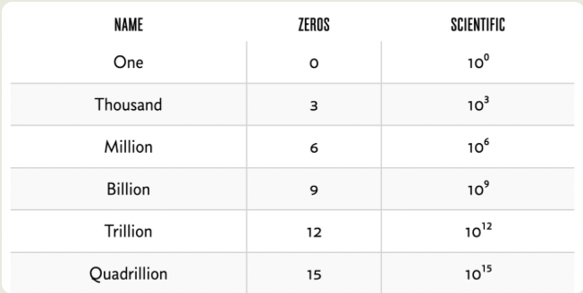
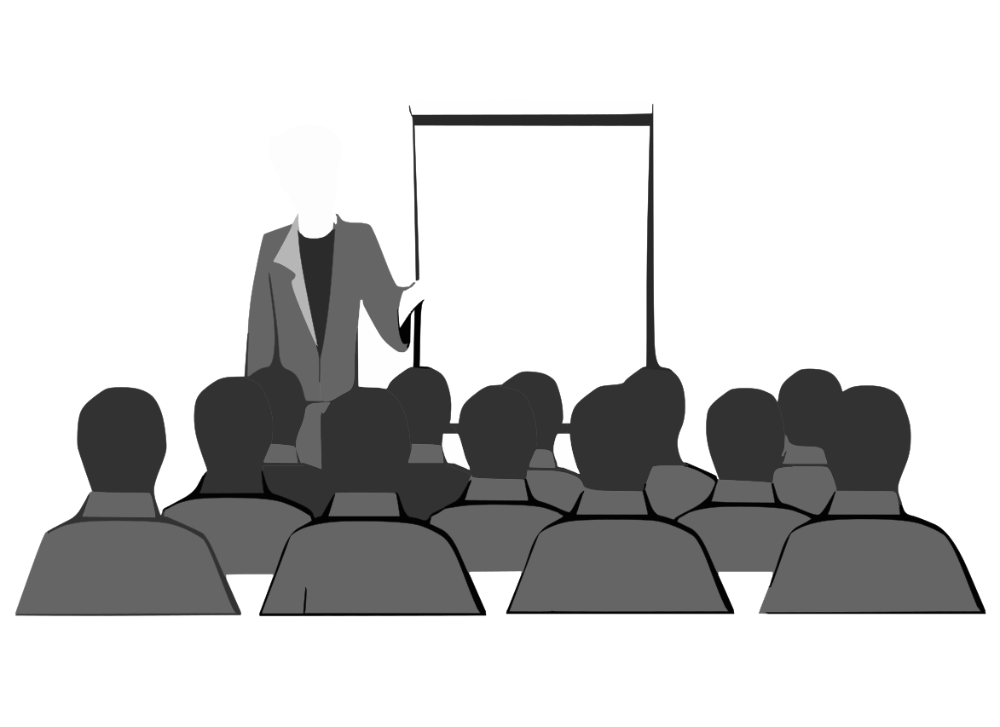
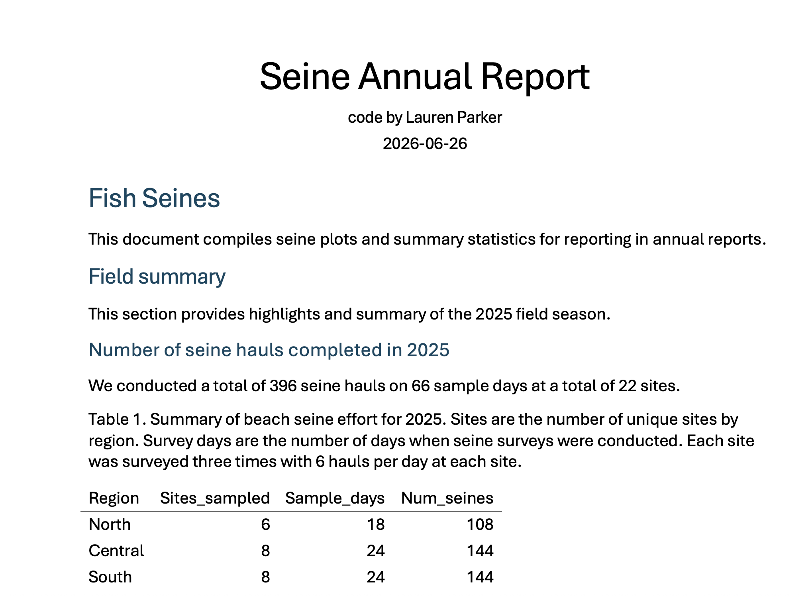
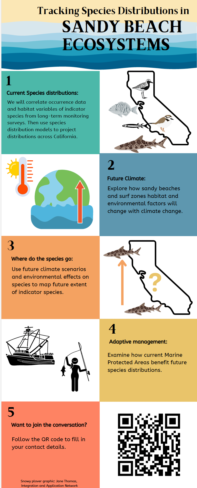

## Learning objectives

This topic focuses on data communication and stakeholders.

By the end of this topic you should be able to:

- Describe some challenges with communicating data
- Describe types of stakeholder
- Characterize narrative frameworks

## Numeric literacy 

Also called numeracy.

Many people have basic numeracy (adding a few numbers in their head, dealing with fractions in baking, etc.) but a large proportion of the adult population has limited numeracy beyond this, despite needing it in everyday life.

## So what?

As a statistician/data scientist, you need to be able to communicate data to people who many not be comfortable with numbers.

## 1 million dollars

One example is the concept of a million dollars vs a billion dollars, people have difficulty understanding the difference but if we change the units it can help illustrate how much bigger one number is compared to another.

1 *million* seconds is approximately 11.57 days (11 days, 13 hours and 46 minutes)

1 *billion* seconds is approximately 31 years and 8 months.

## Communicating data

Target Audience

Make it simple

Report consistently

Avoid technical jargon 

Be a good story teller

## Who are stakeholders

a person such as an employee, customer, or citizen who is involved with an organization, society, etc. and therefore has responsibilities towards it and an interest in its success - Cambridge dictionary

We will use it as people who have a stake in your data, project, etc. who you therefore have a responsibility to.

Client, funder, colleague, scientific community, government agency, local community members, etc

## Goals, audience, and style

Goals of communicating can fall into three broad categories: informing, persuading, or entertaining. It is important to matching the communication type to the goal and audience.

Communicating with a general audience is very different than communicating with a specific community of experts.

In your career you will likely be asked to communicate with many different audiences.

## Tailoring

Tailoring your presentation to each audience is important for effective communication.

Technical expertise: Are they data scientists, business stakeholders, or product managers? What is their level of familiarity with technical terms and concepts?

Goals and objectives: What do they want to achieve from the presentation? Are they looking to inform business decisions, identify new opportunities, or solve a specific problem?

Level of interest: How interested are they in the topic? Are they actively seeking insights or are they being presented with information?

## Know your audience

Not all stakeholders are alike.

Anticipate stakeholders expectations.

Adapt the language, tone, format, and degree of detail.

## Types of data communication

Informal/short form: email updates, blog posts, social media

Formal/longer form: written/technical reports, slide presentations, public appearances

Visual emphasis: posters, info graphics, physical notice boards

## Reports

Reports are typically longer form written communication to stakeholders like funders, government officials, shareholders, etc.

These typically include summary statistics, charts/plots, and explanations of the data.

You should consider what your audience needs to know, what you want them to know, and how you want them to interact with the data.

## Example

## Visuals

Visuals can be included in other communication types of exist on their own.

Visual communication can simplify complex ideas and data and make communication more engaging.

## Infographics

Popular form of visualisation which can include data as well as other points.

These typically include structures such as timelines/journey, comparison, cyclic, or lists. 

https://libguides.hull.ac.uk/infographics/making

## Example

{width=40%}

## Reproducibility in data communication

While communication need to be tailored to individual audiences, there is no need to reinvent the wheel if you communicate with the same audience regularly.

Reproducible frameworks and presentation templates can save you time.

For example in regular reporting (quarterly, annually, etc) you may want to produce the same figures every time. This helps your audience because they already know how to read your report making it quick for them to understand.

Reporting consistently helps build trust in the data.

## Example

Code for CDFW report.

## Presentations 

Oral presentations typically are presented along side a series of slides or images.

Can be a spectrum from traditional style lecture with verbose slides to TED talk with just images.

## Oral presentation tips

- make eye contact
- do not read directly from every slide
- orient your audience to images/plots
- consider the format: slide size, font size, etc
- less is more

## Storytelling in Data Science

Clear narrative structure: Introduce the problem or question, present the findings, and conclude with recommendations or insights.

Data visualization: Use data visualization to support the narrative and illustrate key points.

Emotional connection: Create an emotional connection with the audience by highlighting the impact or implications of the insights.

## Storytelling

Think about movies/films and books. How is the plot set up? 

Both science and storytelling revolve around a "problem-solution" framework. The scientific method begins with identifying a problem and using data to solve it, paralleling the narrative structure where a character faces challenges and seeks solutions.

## Framework

A common science framework:

Introduction: Introduce the problem or question and provide context.

Analysis: Present the findings and insights.

Conclusion: Summarize the key takeaways and provide recommendations.

Call to action: Encourage the audience to take action or engage further with the insights.

IMRAD format (Introduction, Methods, Results, Discussion)

## And, But, Therefore

"Houston we have a narrative" - By Randy Olsen

The ABT has three key components:

1. Agreement (And): Establishes the basic context or facts.
2. Contradiction (But): Introduces a conflict or problem.
3. Consequence (Therefore): Resolves the problem or indicates a path forward.

We can use this to structure reports, scientific papers, abstracts, grant applications, or thesis statements.

## ABT 

Topic X is really important. *AND* We already know some stuff about X. *However*, what we don’t know is Y, and until we solve Y, we’ll never truly understand X. *THEREFORE* Here we solve Y to understand X.

## ABT

- AND: Two sentences of background. 
- BUT: One sentence to define what is unknown. 
- THEREFORE: One sentence to summarise what you did to address this unknown.

## Example Nematodes

"Nematodes Infect, but Do Not Manipulate Digging by, Sand Crabs, \textit{Lepidopa benedicti}."

We examined sand crabs (Lepidopa benedicti) for endoparasites, and found the only parasite consistently infecting the studied population were small nematodes. Because many nematodes have complex life cycles involving multiple hosts, often strongly manipulating their hosts, we hypothesized that nematodes alter the behavior of their sand crab hosts. We predicted that more heavily infected crabs would spend more time above sand than less heavily infected crabs. Our data indicate infection by nematodes was not correlated with duration of time crabs spent above sand. We also suggest that organisms living in sandy beaches may benefit from relatively low parasite loads due to the low diversity of species in the habitat.

## Example Nematodes

"Nematodes Infect, but Do Not Manipulate Digging by, Sand Crabs, \textit{Lepidopa benedicti}."

[THEREFORE]{style="color:green;"} We examined sand crabs (Lepidopa benedicti) for endoparasites, and found the only parasite consistently infecting the studied population were small nematodes. [Because]{style="color:green;"} many nematodes have complex life cycles involving multiple hosts, often strongly manipulating their hosts, we hypothesized that nematodes alter the behavior of their sand crab hosts. We predicted that more heavily infected crabs would spend more time above sand than less heavily infected crabs. Our data indicate infection by nematodes was not correlated with duration of time crabs spent above sand. We also suggest that organisms living in sandy beaches may benefit from relatively low parasite loads due to the low diversity of species in the habitat.

## Why is this a difficult paragraph to follow

Begins by jumping right to a "therefore" statement, saying, "We examined ..." 

This might almost work narratively if the title of the paper posed the question being investigated, which would enable you to jump right from the problem to the solution, but it doesn’t. 

The title is a statement of results: "Nematodes Infect, but Do Not Manipulate Digging by, Sand Crabs, Lepidopa benedicti." The result is that with or without the title, there is no setup, just an immediate narrative direction. 

Then the second half of the first sentence presents results by saying, "and found the only ...," which means we’re now getting results but still have no clear context. 

The second sentence begins with "Because ..." This is another consequence word, like "therefore." Halfway through this sentence is "we hypothesized that ... ," then the next sentence begins with "We predicted ..." 

## Why is this a difficult paragraph to follow

By this point the narrative threads have bent backward and forward several times. 

People who are familiar with the subject matter of this paper might have little trouble following it, but outside of that small group, the narrative is unnecessarily complex, to the detriment of readers.

## Another example

##

Parasites that adaptively manipulate the behavior of their host are among the most exciting adaptations that we can find in nature. The behavior of the host can become an extended phenotype of the parasites within animals such that the success and failure of the parasite’s genome rely on precise change of the host’s behavior. Evolutionary biology was born from the close attention of naturalists such as Wallace and Darwin to phenotypic variation in seeking to understand the origins of new species. In this essay, I argue that we also need to think about the origins of parasite-extended phenotypes. This is a more difficult task than understanding the evolution of textbook examples of novelty such as the eyes of vertebrates or the hooves of horses. However, new tools such as phylogenomics provide an important opportunity to make significant progress in understanding the extended phenotypes of parasites. Knowing the origins of parasite-extended phenotypes is important as a goal all by itself. But the knowledge gained will also help us understand why complex manipulation is so rare and to identify the evolutionary tipping points driving its appearance.

## 

Parasites that adaptively manipulate the behavior of their host are among the most exciting adaptations that we can find in nature. [AND]{style="color:green;"} The behavior of the host can become an extended phenotype of the parasites within animals such that the success and failure of the parasite’s genome rely on precise change of the host’s behavior. [BUT]{style="color:green;"} Evolutionary biology was born from the close attention of naturalists such as Wallace and Darwin to phenotypic variation in seeking to understand the origins of new species. [THEREFORE]{style="color:green;"} In this essay, I argue that we also need to think about the origins of parasite-extended phenotypes. This is a more difficult task than understanding the evolution of textbook examples of novelty such as the eyes of vertebrates or the hooves of horses. However, new tools such as phylogenomics provide an important opportunity to make significant progress in understanding the extended phenotypes of parasites. Knowing the origins of parasite-extended phenotypes is important as a goal all by itself. But the knowledge gained will also help us understand why complex manipulation is so rare and to identify the evolutionary tipping points driving its appearance.

## Notes
This abstract is an argument—as if the author had read and taken to heart Graff and Birkenstein’s They Say, I Say. 

It opens with two clear and straightforward sentences, laying out the “they say” side of the issue. The third sentence does not start with a contradiction word, but if you drop one in you can feel it would work. 

Try it. “But evolutionary biology was born from the close attention of naturalists . . .” You could then add “Therefore” to the next sentence, having, “Therefore in this essay, I argue that . . .” 

So the “but” and “therefore” were not present, but the structure was, providing the tripartite form, clean and simple. 

## ABT words

:::: {.columns}

::: {.column width="30%"}
Agreement (And)

- Also 
- Equally
- Identically
- Uniquely
- Like
- Moreover
- As well as
- Furthermore
- Likewise
- Similarly

:::

::: {.column width="30%"}
Contradiction (But)

- Despite
- However
- Yet
- Conversely
- Rather
- Whereas
- Although
- Otherwise
- Instead
- Albeit

:::

::: {.column width="30%"}
Consequence (therefore)

- So
- Thus
- Consequently 
- Hence
- Thereupon
- Accordingly
- As a result
- Henceforth 
- For this reason
- In that case

:::

::::

## Additional example presentations

[https://youtu.be/2c3rt1p6xZM?si=WnKV8UUcqExzctie](Thriving in Statistics in New Zealand Recording from IDWSDS 2025)

[https://youtu.be/4eYTRlO0Rqw?si=5OyNx3Ik3g--bCNB](Example phd level scientific conference talks)

[https://www.auckland.ac.nz/en/science/about-the-faculty/department-of-statistics/ihaka-lecture-series.html](Ihaka lecture series)

